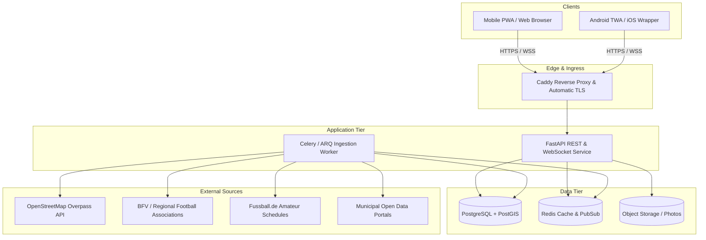
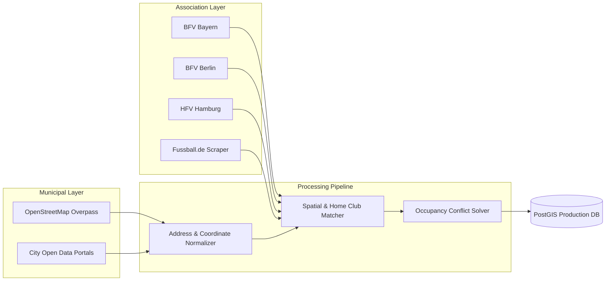
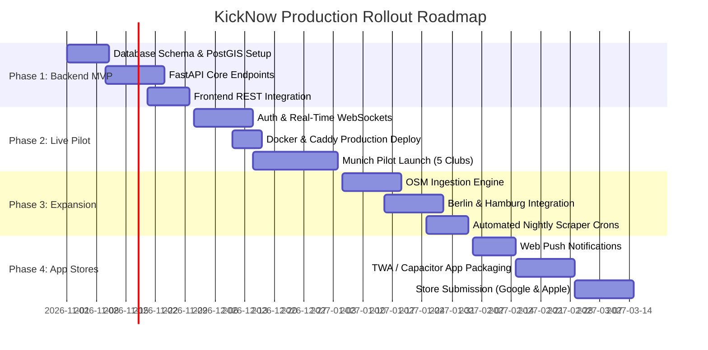

# KickNow Production Rollout Plan

## Goal Description

KickNow is currently a client-only prototype. It runs on a local static server. All data mutations persist only in local browser storage. Pitch data and Bavarian Football Association (BFV) schedules cover only Munich and its surrounding district.

This plan details the technical steps to transform KickNow into a scalable, multi-city production web application. The transition requires a shared backend service, persistent database storage, multi-user real-time coordination, automated data ingestion pipelines across multiple German cities, secure hosting, and regulatory compliance.



---

## User Review Required

> [!IMPORTANT]
> The transition requires replacing client-side mock data in `localStorage` with authenticated REST and WebSocket endpoints. Users without an account can still browse pitches and schedules, but creating games, joining matches, chatting, and submitting reviews will require authentication.

> [!WARNING]
> Web scraping of football association platforms must respect terms of service, robots.txt directives, and data protection regulations. The ingestion engine must not scrape personal player names or contact information. It must store only match metadata, team names, pitch identifiers, and kickoff times.

> [!CAUTION]
> Location coordinates sent by clients must serve only bounding-box queries and distance sorting. User coordinates must never be stored persistently in database tables to comply with European data privacy standards (GDPR / DSGVO).

---

## Open Questions

> [!IMPORTANT]
> 1. **Authentication Strategy**: Should we use passwordless magic link email authentication, OAuth providers (Google and Apple), or phone number SMS verification?
Use phone number verification (local SIM card is enough) or another method if phone number is expensive to scale.
> 2. **Multi-City Target Sequence**: After Munich, which metropolitan areas should follow next? Berlin, Hamburg, Cologne, and Frankfurt have distinct regional associations (BFV Berlin, HFV, FVM, HFV Hessen).
I propose: Munchen, then Nuremberg, then Berlin, then Hamburg, Cologne and Frankfurt in whatever order is most convenient.
> 3. **Hosting Infrastructure**: Do you prefer a self-hosted single-node VPS setup (e.g. Hetzner Cloud with Docker Compose) to keep operating costs low during the pilot, or a managed cloud platform (e.g. AWS, GCP, Fly.io)?
Self-hosted single-node VPS setup.
> 4. **Pitch Booking Liability**: Is KickNow purely an informational and matchmaking tool for open sessions, or should formal pitch rental and payment processing (e.g. via Stripe) be included for private commercial pitches?
Purely informational and matchmaking tool for open sessions. No payment processing.

---

## Proposed Changes

The implementation is structured into five distinct system components:

1. Backend Service and Database Architecture
2. Data Ingestion and Multi-City Scraper Pipeline
3. Client Application Modernization
4. Infrastructure, Hosting, and CI/CD
5. Legal, Compliance, and Moderation

---

### Component 1: Backend Service and Database Architecture

We replace the current local Python static script with a high-performance asynchronous API using FastAPI, SQLAlchemy, and asyncpg. Spatial queries are offloaded from client-side JavaScript to a PostgreSQL database with the PostGIS extension.

#### [NEW] backend/app/main.py
Application entry point. Initializes FastAPI, CORS middleware, database connection pools, and route handlers.

```python
from fastapi import FastAPI
from fastapi.middleware.cors import CORSMiddleware
from app.api.v1 import pitches, bookings, chats, reviews, users, submissions

app = FastAPI(
    title="KickNow API",
    version="1.0.0",
    docs_url="/docs"
)

app.add_middleware(
    CORSMiddleware,
    allow_origins=["https://kicknow.app", "http://localhost:3000"],
    allow_credentials=True,
    allow_methods=["*"],
    allow_headers=["*"],
)

app.include_router(pitches.router, prefix="/api/v1/pitches", tags=["pitches"])
app.include_router(bookings.router, prefix="/api/v1/bookings", tags=["bookings"])
app.include_router(chats.router, prefix="/api/v1/chats", tags=["chats"])
app.include_router(reviews.router, prefix="/api/v1/reviews", tags=["reviews"])
app.include_router(users.router, prefix="/api/v1/users", tags=["users"])
app.include_router(submissions.router, prefix="/api/v1/submissions", tags=["submissions"])
```

#### [NEW] backend/app/models/schema.py
Relational models mapped to PostgreSQL with PostGIS geometry types.

```python
from datetime import datetime
from typing import Optional, List
from sqlmodel import SQLModel, Field, Relationship
from geoalchemy2 import Geometry

class User(SQLModel, table=True):
    __tablename__ = "users"
    id: str = Field(primary_key=True)
    email: str = Field(unique=True, index=True)
    display_name: str
    avatar_url: Optional[str] = None
    created_at: datetime = Field(default_factory=datetime.utcnow)

class Pitch(SQLModel, table=True):
    __tablename__ = "pitches"
    id: str = Field(primary_key=True)
    slug: str = Field(unique=True, index=True)
    name: str
    city: str = Field(index=True)
    district: Optional[str] = None
    address: str
    lat: float
    lng: float
    geom: Optional[Any] = Field(sa_column=Column(Geometry("POINT", srid=4326)))
    surface: str
    cage: bool = False
    access_type: str
    amenities: dict = Field(default={}, sa_column=Column(JSONB))
    is_verified: bool = True

class MatchSchedule(SQLModel, table=True):
    __tablename__ = "match_schedules"
    id: str = Field(primary_key=True)
    pitch_id: str = Field(foreign_key="pitches.id", index=True)
    date: str = Field(index=True)
    start_min: int
    end_min: int
    home_team: str
    away_team: str
    league: str
    source: str

class Booking(SQLModel, table=True):
    __tablename__ = "bookings"
    id: str = Field(primary_key=True)
    pitch_id: str = Field(foreign_key="pitches.id", index=True)
    date: str = Field(index=True)
    slot_index: int
    organizer_id: str = Field(foreign_key="users.id")
    group_size: int
    max_players: int
    level: str
    is_open: bool
    status: str = Field(default="active")
    created_at: datetime = Field(default_factory=datetime.utcnow)

class BookingParticipant(SQLModel, table=True):
    __tablename__ = "booking_participants"
    id: str = Field(primary_key=True)
    booking_id: str = Field(foreign_key="bookings.id", index=True)
    user_id: str = Field(foreign_key="users.id")
    count: int = 1
    joined_at: datetime = Field(default_factory=datetime.utcnow)

class ChatMessage(SQLModel, table=True):
    __tablename__ = "chat_messages"
    id: str = Field(primary_key=True)
    booking_id: str = Field(foreign_key="bookings.id", index=True)
    user_id: str = Field(foreign_key="users.id")
    text: str
    created_at: datetime = Field(default_factory=datetime.utcnow)
```

#### [NEW] backend/app/api/v1/pitches.py
Spatial query endpoint utilizing PostGIS for radius searches and bounding boxes.

```python
from fastapi import APIRouter, Depends, Query
from sqlalchemy.ext.asyncio import AsyncSession
from sqlalchemy import text
from app.db.session import get_session

router = APIRouter()

@router.get("/")
async def list_pitches(
    lat: float = Query(...),
    lng: float = Query(...),
    radius_km: float = Query(default=10.0),
    surface: str = Query(default="alle"),
    session: AsyncSession = Depends(get_session)
):
    sql = text("""
        SELECT id, name, city, district, address, lat, lng, surface, cage, access_type, amenities,
               ST_Distance(geom, ST_SetSRID(ST_MakePoint(:lng, :lat), 4326)::geography) / 1000.0 AS dist_km
        FROM pitches
        WHERE ST_DWithin(geom, ST_SetSRID(ST_MakePoint(:lng, :lat), 4326)::geography, :radius_m)
          AND (:surface = 'alle' OR surface = :surface)
        ORDER BY dist_km ASC
        LIMIT 100
    """)
    result = await session.execute(sql, {
        "lat": lat,
        "lng": lng,
        "radius_m": radius_km * 1000.0,
        "surface": surface
    })
    return [dict(row._mapping) for row in result]
```

---

### Component 2: Multi-City Ingestion and Scraper Pipeline

The current scraper in `scraper/` is specialized for Munich and the BFV portal. To expand to additional cities, we implement a modular data pipeline architecture.



#### [MODIFY] scraper/config.py
Generalize geographical configurations and add city presets for Munich, Berlin, Hamburg, and Frankfurt.

```python
CITIES = {
    "munich": {
        "name": "München",
        "bbox": (47.95, 11.35, 48.30, 11.80),
        "center": (48.137154, 11.576124),
        "association": "BFV",
        "osm_districts": ["München", "Landkreis München"]
    },
    "berlin": {
        "name": "Berlin",
        "bbox": (52.33, 13.08, 52.68, 13.76),
        "center": (52.520008, 13.404954),
        "association": "BFV_BERLIN",
        "osm_districts": ["Berlin"]
    },
    "hamburg": {
        "name": "Hamburg",
        "bbox": (53.38, 9.70, 53.75, 10.35),
        "center": (53.551086, 9.993682),
        "association": "HFV",
        "osm_districts": ["Hamburg"]
    }
}
```

#### [NEW] scraper/osm_importer.py
Harvests soccer pitches from OpenStreetMap using the Overpass API for any defined city bounding box. Extracts surface, access restrictions, lighting, and dimensions.

```python
import requests
from typing import List, Dict, Any

OVERPASS_URL = "https://overpass-api.de/api/interpreter"

def fetch_osm_pitches(bbox: tuple) -> List[Dict[str, Any]]:
    min_lat, min_lng, max_lat, max_lng = bbox
    query = f"""
    [out:json][timeout:60];
    (
      node["leisure"="pitch"]["sport"="soccer"]({min_lat},{min_lng},{max_lat},{max_lng});
      way["leisure"="pitch"]["sport"="soccer"]({min_lat},{min_lng},{max_lat},{max_lng});
    );
    out center tags;
    """
    response = requests.post(OVERPASS_URL, data={"data": query}, timeout=90)
    response.raise_for_status()
    elements = response.json().get("elements", [])
    
    results = []
    for el in elements:
        tags = el.get("tags", {})
        lat = el.get("lat") or el.get("center", {}).get("lat")
        lng = el.get("lon") or el.get("center", {}).get("lon")
        if not lat or not lng:
            continue
            
        surface_raw = tags.get("surface", "unbekannt").lower()
        surface_map = {
            "grass": "Rasenplatz",
            "artificial_turf": "Kunstrasen",
            "asphalt": "Asphalt",
            "clay": "Hartplatz",
            "sand": "Hartplatz"
        }
        
        results.append({
            "osm_id": el["id"],
            "name": tags.get("name") or "Bolzplatz",
            "lat": lat,
            "lng": lng,
            "surface": surface_map.get(surface_raw, "Rasenplatz"),
            "lit": tags.get("lit") == "yes",
            "access": "Öffentlich" if tags.get("access") in [None, "yes", "public"] else "Vereinsgelände"
        })
    return results
```

#### [NEW] scraper/fussball_de_scraper.py
Amateur match scraper for national coverage across all state football associations, aggregating club fixture calendars via Fussball.de URLs.

#### [NEW] scraper/scheduler.py
Automated ingestion task scheduled with a cron runner or Celery Beat. Runs nightly at 03:00 to refresh upcoming weekly match assignments and updates the database without manual commands.

---

### Component 3: Client Application Modernization

The web frontend in `kicknow/` is updated to replace static arrays and `localStorage` with authenticated HTTP and WebSocket communication.

#### [MODIFY] kicknow/js/app.js
- Replace `localStorage` sync with REST calls (`fetch('/api/v1/...')`).
- Introduce an authentication token state (`authToken = localStorage.getItem('kn_token')`).
- Add WebSocket listener for instant real-time chat messages and slot occupancy changes.
- Add city selection dropdown in the search header, enabling users to switch between Munich, Berlin, and Hamburg.
- Retain the existing bottom-sheet gestures, visual tokens, and MapLibre GL custom vector maps.

```javascript
// Example API connector in app.js
const API_BASE = window.location.origin.includes('localhost')
  ? 'http://localhost:8000/api/v1'
  : '/api/v1';

async function apiRequest(path, options = {}) {
  const token = localStorage.getItem('kn_token');
  const headers = Object.assign({ 'Content-Type': 'application/json' }, options.headers);
  if (token) headers['Authorization'] = `Bearer ${token}`;
  const res = await fetch(`${API_BASE}${path}`, Object.assign({}, options, { headers }));
  if (!res.ok) throw new Error(`API error: ${res.status}`);
  return res.json();
}
```

#### [NEW] kicknow/service-worker.js
Service Worker for full Progressive Web App (PWA) offline caching, background sync, and Web Push notifications for game reminders.

---

### Component 4: Infrastructure, Hosting, and CI/CD

#### [NEW] docker-compose.prod.yml
Production container definitions including Caddy, the FastAPI backend, PostgreSQL with PostGIS, and Redis.

```yaml
version: '3.8'

services:
  caddy:
    image: caddy:2-alpine
    restart: always
    ports:
      - "80:80"
      - "443:443"
    volumes:
      - ./Caddyfile:/etc/caddy/Caddyfile
      - ./kicknow:/srv/kicknow
      - caddy_data:/data
      - caddy_config:/config
    depends_on:
      - api

  api:
    build:
      context: ./backend
      dockerfile: Dockerfile
    restart: always
    environment:
      - DATABASE_URL=postgresql+asyncpg://kicknow:${DB_PASSWORD}@db:5432/kicknow
      - REDIS_URL=redis://redis:6379/0
      - SECRET_KEY=${SECRET_KEY}
    depends_on:
      - db
      - redis

  db:
    image: postgis/postgis:16-3.4-alpine
    restart: always
    environment:
      - POSTGRES_USER=kicknow
      - POSTGRES_PASSWORD=${DB_PASSWORD}
      - POSTGRES_DB=kicknow
    volumes:
      - pgdata:/var/lib/postgresql/data

  redis:
    image: redis:7-alpine
    restart: always
    volumes:
      - redisdata:/data

volumes:
  caddy_data:
  caddy_config:
  pgdata:
  redisdata:
```

#### [NEW] Caddyfile
Reverse proxy setup providing automatic HTTPS via Let's Encrypt, compression, caching headers for static assets, and WebSocket proxying.

```caddyfile
kicknow.app {
    encode gzip zstd

    # Backend API and WebSocket proxy
    handle /api/* {
        reverse_proxy api:8000
    }
    handle /ws/* {
        reverse_proxy api:8000
    }

    # Static PWA App Files
    handle {
        root * /srv/kicknow
        file_server
        try_files {path} /index.html
    }
}
```

---

### Component 5: Legal, Privacy, and Community Moderation

1. **GDPR / DSGVO Compliance**:
   - Explicit privacy policy (`/datenschutz`) explaining location data usage. Location coordinates are used only ephemerally in-memory for spatial filtering.
   - Legal notice (`/impressum`) in accordance with § 5 DDG (former TMG).
   - Account deletion function with automated data sanitization (Art. 17 GDPR).
2. **Community Pitch Submissions**:
   - A dedicated moderation queue (`/api/v1/submissions`). Newly submitted public mini-pitches or cages require confirmation by two distinct users or admin approval before becoming visible on the map.
3. **Abuse Prevention**:
   - Rate limiting on chat messages and bookings via Redis token bucket.
   - Content reporting flag on reviews and chat messages.

---

## Phased Implementation Roadmap



### Phase 1: Persistence and Backend Migration (Weeks 1 to 3)
- Provision PostgreSQL with PostGIS.
- Migrate existing `data/scraped_pitches.json` and `data/bfv_matches.json` into relational tables.
- Implement REST API endpoints for pitches, slots, and bookings.
- Refactor `kicknow/js/app.js` to fetch live data from the API instead of `data.js`.

### Phase 2: Multi-User Real-Time Pilot in Munich (Weeks 4 to 6)
- Implement user authentication (magic links and Google sign-in).
- Add WebSocket support for real-time match chats and slot updates.
- Deploy Docker stack on a production VPS with automatic SSL.
- Conduct a closed beta with 3 to 5 Munich football clubs and local amateur players.

### Phase 3: National Scraper Engine and City Expansion (Weeks 7 to 9)
- Deploy the OpenStreetMap Overpass extraction tool for automatic pitch harvesting.
- Build scrapers for Berlin (BFV Berlin) and Hamburg (HFV).
- Set up automated nightly match schedule imports with failure alerting.
- Release multi-city search in the client interface.

### Phase 4: App Store Packaging and Public Release (Weeks 10 to 12)
- Configure Web Push notifications for match coordination and player arrivals.
- Package the PWA as a Trusted Web Activity (TWA) for Google Play and Capacitor for Apple App Store.
- Public launch and community promotion.

---

## Verification Plan

### Automated Tests

1. **Backend Integration and API Tests**:
   ```bash
   pytest backend/tests/ -v
   ```
   Validates spatial distance queries, booking concurrency locks, authentication token validation, and rate limiting.

2. **Scraper Extraction and Parsing Tests**:
   ```bash
   python3 -m unittest scraper/test_scraper.py
   ```
   Validates OSM parsing, association PDF extraction, and address fuzzy matching.

3. **Database Migration Verifications**:
   ```bash
   alembic upgrade head
   ```

### Manual Verification

1. **Multi-Device Match Sync**: Open KickNow on two separate mobile devices. Create a match on Device A. Verify that Device B immediately displays the new game in the slot calendar without manual page refreshes.
2. **Spatial Search Accuracy**: Search for pitches in different Munich districts and verify that returned results match true geographical proximity.
3. **Multi-City Switcher**: Switch the active city to Berlin or Hamburg. Ensure that the map camera centers properly, local pitches render, and local district suggestions populate the search bar.
4. **Offline and PWA Install**: Test installation on an Android device via Chrome and an iOS device via Safari. Verify that the app shell loads in offline airplane mode.
